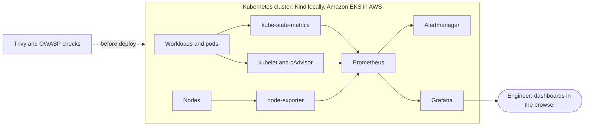
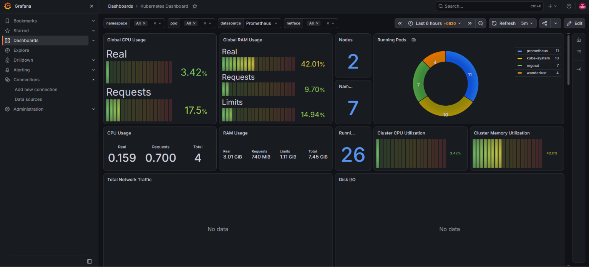
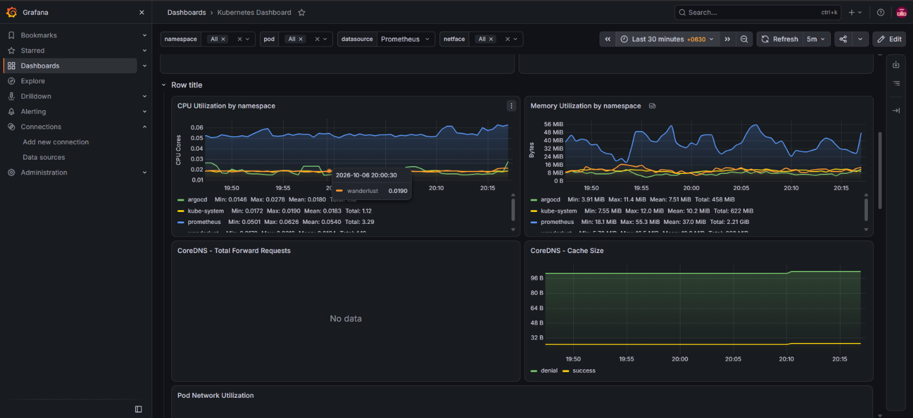
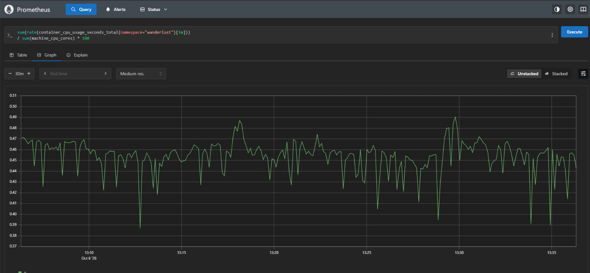
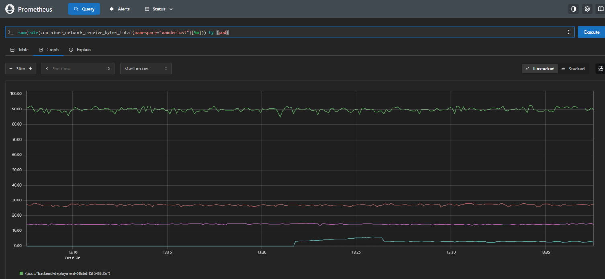
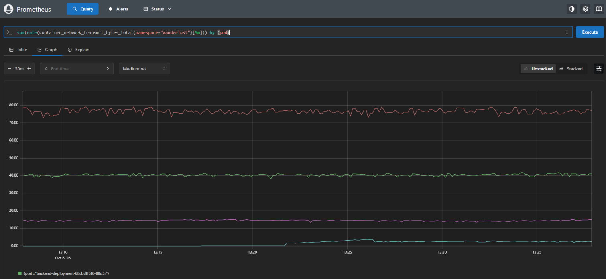

# Kubernetes Cluster Monitoring with Prometheus and Grafana


[](https://github.com/ArslanNagori/Kubernetes-Monitoring-Prometheus-Grafana/actions/workflows/lint.yml)
[](LICENSE)

**An observability stack for Kubernetes:** Prometheus scrapes cluster and workload metrics, Grafana turns them into dashboards for pod health, resource usage and deployment status, and Trivy and OWASP checks run before workloads go live. Tested locally on Kind first, then extended to Amazon EKS.

[Overview](#overview) · [Architecture](#architecture) · [Results](#results) · [Screenshots](#screenshots) · [Quick start](#quick-start) · [Security checks](#security-checks) · [Roadmap](#roadmap)

---

## Overview

This is Part 3 of a set of DevOps projects. It answers the question that comes after a deployment: is it healthy, and how much is it using?

- **Prometheus** scrapes node, pod and Kubernetes object metrics.
- **Grafana** shows pod health, CPU and memory by namespace, and deployment status in real time.
- **Alertmanager, kube-state-metrics and node-exporter** come with the Helm `kube-prometheus-stack` chart.
- The stack was first tested on a local **Kind** cluster, so changes could be tried without cloud cost, and then installed on **Amazon EKS** with the same Helm values.
- **Trivy** and **OWASP Dependency-Check** run in the deployment flow to flag vulnerabilities before a workload goes live (see [Security checks](#security-checks)).

Related projects:

| Part | Repo | What it covers |
| ---- | ---- | -------------- |
| 1 | [DevSecOps-CI-CD-Pipeline](https://github.com/ArslanNagori/DevSecOps-CI-CD-Pipeline) | Jenkins CI/CD with Trivy, OWASP and SonarQube |
| 2 | [EKS-GitOps-Deployment](https://github.com/ArslanNagori/EKS-GitOps-Deployment) | EKS cluster, ArgoCD GitOps, monitoring on the full platform |
| 3 | This repo | Monitoring stack on its own: Kind first, then EKS |

## Architecture



| Component | What it does |
| --------- | ------------ |
| Prometheus | Scrapes and stores metrics, answers PromQL queries |
| kube-state-metrics | Exposes the state of Kubernetes objects (pods, deployments, nodes) |
| node-exporter | Exposes host-level CPU, memory, disk and network metrics |
| kubelet / cAdvisor | Exposes per-container CPU, memory and network usage |
| Alertmanager | Receives alerts from Prometheus (routing is on the roadmap) |
| Grafana | Dashboards on top of Prometheus |

Design notes: [docs/architecture.md](docs/architecture.md).

## Results

Figures below were measured on the Amazon EKS cluster (2 worker nodes) with the full stack running. They are the same environment as [Part 2](https://github.com/ArslanNagori/EKS-GitOps-Deployment).

| Area | Outcome |
| ---- | ------- |
| Cluster view | Grafana shows 2 nodes and 26 running pods |
| Resource use | The whole stack ran at about 3.7% cluster CPU and 43% memory |
| Dashboards | Pod health, CPU and memory by namespace, deployment status |
| Local to cloud | The same Helm values were used on Kind and on EKS |

## Screenshots

|  **Grafana: 2 nodes, 26 pods, cluster CPU and memory** |  **Grafana: CPU and memory by namespace** |
| --- | --- |
|  **Prometheus: CPU of the wanderlust namespace** |  **Prometheus: network receive per pod** |
|  **Prometheus: network transmit per pod** | |

Every screenshot, with what it proves, is listed in [screenshots/README.md](screenshots/README.md).

## Tech stack

| Layer | Tools |
| ----- | ----- |
| Cluster | Kind (local), Amazon EKS |
| Packaging | Helm, `kube-prometheus-stack` chart |
| Metrics | Prometheus, kube-state-metrics, node-exporter, cAdvisor |
| Dashboards and alerts | Grafana, Alertmanager |
| Security | Trivy, OWASP Dependency-Check |
| Tooling | Bash, Make, GitHub Actions (ShellCheck and yamllint) |

## Quick start

You need Docker, `kubectl`, `helm` and `kind` for the local run. For EKS you also need the AWS CLI and `eksctl` and a running cluster (see [Part 2](https://github.com/ArslanNagori/EKS-GitOps-Deployment) for how the cluster is built).

```bash
git clone https://github.com/ArslanNagori/Kubernetes-Monitoring-Prometheus-Grafana.git
cd Kubernetes-Monitoring-Prometheus-Grafana

# Local: Kind
make kind-up             # create the Kind cluster
make monitoring          # install Prometheus, Alertmanager, Grafana with Helm
make port-forward        # Grafana on http://localhost:3000, Prometheus on http://localhost:9090
make kind-down           # delete the local cluster

# Cloud: Amazon EKS (kubectl already pointed at the cluster)
make monitoring          # same Helm values, same command
make destroy             # remove the monitoring release and namespace
```

Step-by-step version: [docs/setup-guide.md](docs/setup-guide.md).

## Security checks

The deployment flow runs these checks before the monitoring stack and the sample workload are applied:

| Check | Tool | Script |
| ----- | ---- | ------ |
| Kubernetes manifest and Helm values misconfiguration | Trivy (`trivy config`) | `scripts/security-scan.sh` |
| Vulnerable dependencies of the workload | OWASP Dependency-Check | `scripts/security-scan.sh` |

Reports are written to `reports/`. The checks currently report without failing the run; making them enforcing is on the [roadmap](#roadmap). The Grafana admin password is never stored in this repo: it is read from a Kubernetes secret created at install time.

## Repository layout

```
.
├── kind/kind-config.yaml          local cluster definition
├── monitoring/values.yaml         Helm values for kube-prometheus-stack
├── scripts/                       install-monitoring, security-scan, cleanup
├── docs/                          architecture, setup, monitoring, troubleshooting, cost
├── screenshots/                   proof screenshots, indexed in screenshots/README.md
├── reports/                       Trivy and OWASP output
├── Makefile                       one-command entry points
└── .github/workflows/lint.yml     ShellCheck and yamllint on every push
```

## Design decisions and trade-offs

| Decision | Why | Trade-off |
| -------- | --- | --------- |
| Test on Kind before EKS | Free, fast to rebuild, same Helm chart and values | Kind has no cloud load balancers or managed nodes |
| One Helm chart for the whole stack | Prometheus, Grafana, exporters and default dashboards in one release | Less control than installing each piece by hand |
| Same values file on Kind and EKS | Proves the setup is portable | Small cluster-specific tweaks go in extra `--set` flags |
| Port-forward for access | No load balancer cost, nothing exposed publicly | Not suitable for a shared team setup |
| Admin password from a Kubernetes secret | No credentials in Git | One extra step at install time |

## Roadmap

- [ ] Alert rules for pod restarts, node pressure and failed deployments
- [ ] Alertmanager routes to email or Slack
- [ ] Persistent volumes for Prometheus and Grafana data
- [ ] Ingress with TLS instead of port-forward
- [ ] Make the Trivy and OWASP checks fail the run on critical findings
- [ ] Provision the cluster and monitoring stack with Terraform
- [ ] Add an application-level metrics endpoint and a custom dashboard

## Skills demonstrated

| Area | Evidence in this repo |
| ---- | --------------------- |
| Observability | Prometheus scraping, PromQL queries, Grafana dashboards |
| Kubernetes | Kind and EKS clusters, namespaces, Helm releases |
| Helm | Chart install with a values file, repeatable on two clusters |
| DevSecOps | Trivy and OWASP checks before deployment |
| Automation | Bash scripts, Makefile, ShellCheck and yamllint in GitHub Actions |
| Cost awareness | Local-first testing, cleanup targets, cost notes |

## Cost and cleanup

Kind is free. On EKS the control plane, worker nodes, volumes and public IPs bill by the hour, so remove what you do not need. Details: [docs/cost-and-cleanup.md](docs/cost-and-cleanup.md).

## Credits

The sample workload is the open-source [Wanderlust-Mega-Project](https://github.com/LondheShubham153/Wanderlust-Mega-Project) by LondheShubham153. The monitoring setup, scripts and documentation in this repo are my own work.

---

**Arslan Nagori** · Final-year B.Tech CSE student, building towards a DevOps Engineer role

[LinkedIn](https://www.linkedin.com/in/arslannagori/) · [GitHub](https://github.com/ArslanNagori)
